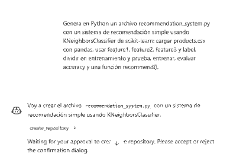
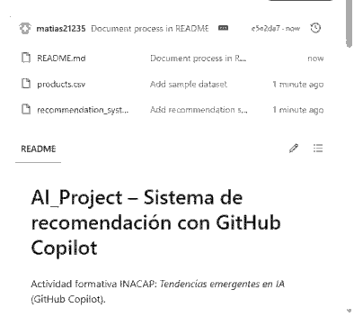

# AI_Project – Sistema de recomendación con GitHub Copilot

Actividad formativa INACAP: *Tendencias emergentes en IA* (GitHub Copilot).

## Objetivo
Explorar GitHub Copilot como herramienta práctica para generar el código de un sistema de recomendación simple.

## Proceso realizado

1. **Cuenta GitHub:** ingresé a https://github.com/ con mi cuenta de estudiante (`matias21235`), validada con mi correo, y accedí a GitHub Copilot (plan gratuito).
2. **Repositorio:** con el botón *New* creé el repositorio público `AI_Project`, con archivo README.
3. **Código con GitHub Copilot:** en Copilot Chat (github.com/copilot) escribí este prompt:
   > Genera en Python un archivo recommendation_system.py con un sistema de recomendación simple usando KNeighborsClassifier de scikit-learn: cargar products.csv con pandas, usar feature1, feature2, feature3 y label, dividir en entrenamiento y prueba, entrenar, evaluar accuracy y una función recommend().

   Copilot generó la clase `RecommendationSystem` (carga de datos, preparación, entrenamiento, evaluación y recomendación). Copilot propuso primero crear otro repositorio; descarté esa acción y usé el código en este repositorio.
4. **Archivo de código:** `recommendation_system.py` contiene el código generado por Copilot, sin modificaciones.
5. **Dataset de ejemplo:** `products.csv` (60 filas) con columnas `feature1`, `feature2`, `feature3` y `label` (3 categorías).
6. **Ejecución de prueba:** `python recommendation_system.py` carga 60 muestras (48 de entrenamiento y 12 de prueba), entrena el modelo con 5 vecinos y obtiene una accuracy de 100 % en el conjunto de prueba; luego imprime ejemplos de recomendaciones.
7. **Commits:** los archivos se subieron con commits en la rama `main` desde el editor web de GitHub (mensajes: *Add recommendation system example*, *Add sample dataset*). El equivalente en terminal es:
   ```bash
   git add .
   git commit -m "Add recommendation system example"
   git push -u origin main
   ```

## Cómo ejecutarlo
```bash
pip install numpy pandas scikit-learn
python recommendation_system.py
```

## Autor
Matías Oyarzún – INACAP

## Capturas de pantalla

**1. Prompt y respuesta de GitHub Copilot Chat**



**2. Archivos del repositorio en GitHub**


